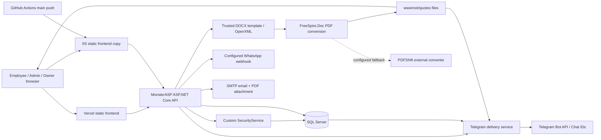

# Security audit and RBAC implementation plan

**Repository:** AbdallahSay/factory-quote-generator

**Reviewed revision:** `22b4d56` (local HEAD; 19 October 2026 commit)

**Audit date:** 20 October 2026, Africa/Cairo

**Status:** Audit and proposed design only. Implementation requires review. No application changes, deployment, production database access, real notifications, or production attack tests were performed.

## 1. Executive assessment

**Overall risk: High. Do not treat the existing role/password screens as a complete authorization boundary.** The backend authenticates quotation generation, but exposes quotation records, associated user password hashes, client contacts, and quotation files without authentication. Stored data reaches executable HTML contexts in the administrative UI. Admin can manage employee accounts despite the required Owner-only boundary. Publicly known bootstrap passwords and predictable signing configuration create additional conditional compromise paths.

There is no evidence from this audit that production has been compromised, uses a default password/key, or has the same schema and binaries as this revision. The findings below distinguish demonstrated local behavior, code-confirmed defects, and deployment-dependent exposure. A Critical rating applies to the default Owner credential **if an instance seeded it and has not replaced it**; no live login was attempted.

Useful foundations already exist: unique employee emails, salted PBKDF2 password hashes, constant-time HMAC verification, server-derived identity for new quotations, immediate disabled-account checks for employee tokens, password-reset invalidation, restricted user deletion when quotations exist, SQL sequence allocation, delivery history, and sequential Telegram duplicate suppression. Preserve these while closing the gaps.

**Recommended first application fix after review:** protect `GET /api/quotes/{id}` with authenticated object authorization and return an explicit quotation DTO excluding the entire `User` entity and password material. It is a small, high-impact containment change with no SQL migration or Telegram behavior change. In parallel, have the operator privately check whether bootstrap credentials or a placeholder/fallback signing key are active; rotate any confirmed defaults through a rehearsed process. Do not rotate or deploy automatically from this audit.

## 2. Scope, evidence, and limitations

All tracked C# controllers, services and interfaces, models, DTOs, EF mapping, SQL setup, HTML/JavaScript surfaces, configuration, workflow, IIS configuration, project dependencies, README and changelog were reviewed. Both `frontend/` and `backend/wwwroot/` matter: IIS serves a second UI, whose admin page differs from the Vercel copy. The trusted Word template is an application asset, not an employee upload endpoint. Read-only ZIP inventory of the tracked DOCX found 29 package entries, zero external relationships, zero macro parts and zero embedded-object parts; this is not a full document-malware assessment.

Evidence uses repository-relative `file:line` references at the revision above. Start here for immutable source context: [reviewed repository tree](https://github.com/AbdallahSay/factory-quote-generator/tree/22b4d56). Passwords, signing keys, bot tokens, session tokens, and production connection strings are deliberately omitted from this report.

The workspace also contains ignored Python applications, an older `FactoryQuoteApi/`, local SQL/reset/deployment scripts, tests, databases and generated files. `.gitignore:46–67` excludes these; the checked-in workflow publishes `backend/FactoryQuoteApi.csproj`, not those older applications. They were inventoried to avoid accidentally running live or destructive tools. Their application behavior is outside this revision's deployed-source assessment. The Python PDF fallback references an ignored `scripts/docx_to_pdf.py`; its presence on the server is unverified.

A narrow, redacted historical scan inspected 135 distinct reachable text blobs using database-password and Telegram-token patterns. Seventeen candidates reduced to bootstrap defaults and variable/environment expressions after review; it did not confirm an additional real database or Telegram secret. This is not a comprehensive entropy/credential scan, proof of rotation, or inspection of GitHub/Vercel/MonsterASP secret stores. Ignored production configuration and real databases were not used as test inputs.

Not verified: deployed revision; actual IIS/edge security headers and TLS rules; production credentials, database privileges/schema/indexes; host backups and file ACLs; branch protection, GitHub environment approvals and workflow token defaults; Vercel account/project settings; Telegram webhook ownership; current external recipients; SMTP or WhatsApp gateway configuration. These remain production verification tasks, not assumptions of exploitability.

### 2.1 Safe local validation performed

Supporting audit-only sources are in [`validation/`](validation/). Run from the repository root:

```powershell
dotnet run --project docs/security/validation/AuditHarness.csproj
node docs/security/validation/frontend-checks.cjs
dotnet list backend/FactoryQuoteApi.csproj package --vulnerable --include-transitive --format json
```

The harness references the real controller/service code but **does not execute application startup**. It uses EF InMemory, fabricated users and credentials, a temporary directory containing synthetic documents, mock PDF/sequence/notification services, and an `HttpMessageHandler` that never opens sockets. The real OpenXML writer is exercised against a synthetic template. Reading configuration is limited to tracked `backend/appsettings.json` placeholders, without environment providers. NuGet restore/advisory retrieval is the only external network dependency of these commands.

Observed results: **31 C# checks and 6 JavaScript checks passed**. These are baseline assertions of present behavior, including vulnerabilities; green does not mean secure. After fixes, turn vulnerability assertions into denial/regression expectations.

| Check group | Observed result |
| --- | --- |
| Default bootstrap and signing configuration | Tracked placeholders seed working quote/admin/owner defaults in a fresh isolated database; public placeholder signing key plus the disclosed synthetic employee hash permits forging that employee's token. Wrong signature rejected. |
| Anonymous exposure | Quote read returns a serialized `User.PasswordHash`; file action returns `PhysicalFileResult`; client list is accessible. Anonymous generate and preview are rejected. |
| Identity and roles | Admin creates an employee; Employee cannot. Employee submits an audit record attributed to another user. A legacy shared quote token can still generate. New quotation and generation audit ignore frontend `UserId` and use the authenticated employee. |
| Session lifecycle | Logout leaves bearer token valid. Disabling rejects it; reenabling without another change revives it. Password reset rejects the old token. |
| Documents | Different quote numbers for the same client/project produce the same filename; the real Word writer overwrites the first document. |
| Telegram | Synthetic PDF bytes and DB-derived creator name sent; sequential Sent retry skipped; zero active recipients falls back to configuration; unregistered explicit Chat ID accepted; two concurrent retries of an existing Pending record produce two sends; bot-info invokes deleteWebhook. |
| Frontend | Actual renderer functions place an inert HTML event-handler marker into quote/log `innerHTML` in both admin copies and detected Telegram chats in the Vercel copy. Network failure makes `Auth.verify` return true. |
| CORS | Source suffix predicate accepts an arbitrary Vercel tenant and a suffix-lookalike hostname. |

These are controller/service tests, not a deployed HTTP penetration test. EF InMemory does not enforce SQL Server foreign keys or uniqueness. The concurrency test starts with an existing Pending delivery, so it demonstrates the missing send lock independently of insertion constraints. JavaScript checks capture HTML sinks without executing payloads in a real browser; browser-specific exploit execution and CSP effects were not tested. No load, brute-force, SQL migration, SMTP, WhatsApp, real Telegram, or production file-download test was run.

## 3. Architecture and data flows



### 3.1 Frontend and workflows

* `frontend/config.js:9–13` selects localhost HTTP in development or the HTTPS MonsterASP API in production; `window.ENV_API_URL` can override it. `frontend/vercel.json` rewrites `/`, `/admin`, `/owner`, adds a static wildcard CORS header and `X-Frame-Options`. That header does not secure the backend API.
* Employees use email/password through `Auth.employeeLogin`; the quote page verifies a token, loads client/product suggestions and terms, edits dynamic rows/terms, previews, then generates. Results provide PDF/DOCX links and a PDF Blob for browser Web Share/WhatsApp (`frontend/index.html:383–1235`). There is no public account registration UI or endpoint.
* Admin uses a shared role password, reads statistics/latest 50 quotations/latest 100 audit logs, manages employees, manages independent Telegram recipients and retries deliveries. Switching to Telegram calls bot-info (`frontend/admin.html:391–418,1087–1126`).
* Owner uses a separate shared role password and can change only the shared quote/admin passwords (`frontend/owner.html:179–280`; `AuthController.cs:120–166`). The UI does not manage unique Owner/Admin identities or rotate the Owner password. Owner tokens are accepted by backend admin gates, but the admin UI verifies/stores the separate admin role token.
* `Auth` stores seven-day bearer tokens in localStorage by default, or sessionStorage. Employee and quote share one token key. Separate role keys can coexist on the same origin. Displayed user data is cached separately; backend checks, not this cache, determine identity. `Auth.verify` treats network errors as valid for UI purposes (`auth.js:1–185`, both copies).

### 3.2 Backend, authentication and SQL

`Program.cs` registers controllers, SQL Server EF, document/notification/security/sequence/Telegram services, HttpClient factory and a bounded in-memory queue. There is no ASP.NET authentication scheme, authorization middleware/fallback policy, rate limiter, or antiforgery middleware. Selected actions manually parse bearer headers and call `SecurityService`; missing a manual gate leaves an action public. CORS is registered and called twice; the duplication provides no additional authorization.

Employee authentication normalizes email, verifies a PBKDF2-SHA256 hash and checks `IsActive`. A signed token contains an employee identifier, a suffix derived from the password hash, and expiry. Every employee token is labelled `employee`, regardless of `Users.Role`. Shared role tokens contain role, database `SessionSalt` and expiry. Validation rechecks those database values; shared tokens are assigned an arbitrary existing Admin/first User as their apparent creator (`SecurityService.cs:155–338`). These are custom signed tokens, not JWTs. Roles in `SystemCredentials` and `Users.Role` are separate systems.

| Entity / object | Purpose and important constraints |
| --- | --- |
| Users | Identity, FullName, unique Email, PasswordHash, legacy `Admin`/`Sales` Role, IsActive, CreatedAt. No normalized-email column, session table, invitation/reset-token flow or security version. |
| SystemCredentials | Role primary key, shared PasswordHash, SessionSalt, UpdatedAt. Independent of Users. |
| Clients / Products | Global suggestion catalogs. Clients contain phone/email/address and optional creator FK. Products contain active flag and default prices. |
| Quotes / QuoteItems | Client/project snapshots, issuer fields, totals, public URLs, timestamps; unique quote number; required UserId FK; separate nullable CreatedByUserId scalar without explicit FK mapping. Items cascade on quote deletion. Dynamic table text is rendered into the document; the full arbitrary grid is not retained as a normalized SQL table. |
| AuditLogs | Required UserId FK, free-form Action/EntityId and server timestamp. Users with logs cannot normally be deleted under EF restrictive FK behavior. |
| TelegramRecipients | Unique ChatId, independent DisplayName/IsActive/CreatedAt. No employee-account association: preserve this separation. |
| QuoteTelegramDeliveries | Quote FK, unique `(QuoteId, ChatId)`, QuoteNumber, Pending/Sent/Failed, message ID, error, RetryCount, SentAt/CreatedAt. No persisted Telegram document file ID/hash or attempt/lease table. |
| QuoteNumberSequence | Startup-created SQL sequence; index on QuoteNumber. Allocation falls back to Count+1 if SQL sequence fails, which is not safe under concurrency. |

Entity/constraint evidence: `Models/Entities.cs:6–158`, `Models/SystemCredential.cs`, `Data/ApplicationDbContext.cs:20–68`, `QuoteSequenceService.cs:16–88`. `database/database_setup.sql` creates only the older six-table schema and omits newer quote columns and security/Telegram objects. `EnsureCreated` is not a migration system.

### 3.3 Quotation, documents and integrations

1. `POST /api/quotes/generate` validates a bearer token and requires a resolved User. The body `UserId` is ignored. It accepts legacy Items or arbitrary Headers/Rows, cleans issuer text, derives item totals, and falls back to caller `TotalAmount` when computed total is nonpositive.
2. It allocates a quote number, writes DOCX under `wwwroot/quotes`, converts PDF, builds absolute URLs using request scheme/host, then commits Quote + Items + generation AuditLog. Files exist before the database transaction is committed (`QuotesController.cs:52–215`).
3. It **awaits** automatic Telegram PDF delivery after the save, then optional WhatsApp webhook and SMTP. Exceptions in these notification paths do not fail the saved quotation. The response is not returned until these awaited operations finish (`QuotesController.cs:229–287`).
4. Preview requires quote/admin/owner or employee authorization, writes GUID-named DOCX/PDF without a Quote record, peeks the sequence, sends no notifications and deletes old previews opportunistically after one hour (`QuotesController.cs:310–452`). This is not a guaranteed retention job.
5. The Word generator clones a server-owned DOCX and modifies paragraphs, SmartArt, table cells, terms and issuer signature using OpenXML text nodes. PDF conversion tries local FreeSpire.Doc, configured PDFShift, then an optional ignored Python script (`WordQuoteGeneratorService.cs:65–141`; `PdfConverterService.cs:27–163`). PDFShift receives the document if that fallback runs; confirm this data transfer is approved. No template/file-upload API was found.
6. Telegram reads bytes from disk, checks for a PDF signature, calculates SHA256, builds a caption from DB creator identity and quote fields, then uploads a PDF attachment using multipart `sendDocument`. It does not need a public PDF URL. It saves per-chat Pending/Sent/Failed history and avoids a later sequential send after Sent (`TelegramDeliveryService.cs:247–587`).
7. Automatic recipients come from active database rows, except the fallback described in F09. Specific/bulk manual retry has different recipient semantics. RetryCount tracks failures, not all attempts. There is no scheduled backoff/retry sweeper or durable queue/outbox. The registered Channel queue has no quotation enqueue call; its hosted worker uses unawaited `Task.Run` and is not durable (`BackgroundQueue.cs:15–86`). README claims of asynchronous notifications do not match the current quote controller.
8. WhatsApp posts a JSON payload including PDF URL to an administrator-configured URL; missing phone skips it. SMTP sends the local PDF to caller-specified client email; missing email skips it. Browser WhatsApp sharing is a separate Web Share file flow. Do not break either path by merely adding bearer checks to existing public links (`NotificationService.cs:34–139`; `frontend/index.html:1153–1213`).

### 3.4 Deployment and trust boundaries

`.github/workflows/deploy-backend.yml:3–83` builds/publishes on **every push to main**, including documentation-only pushes, and on manual dispatch. It restores un-locked dependencies, conditionally skips tests if no `tests/*.csproj` exists, takes IIS offline, uploads to `/wwwroot/`, removes the offline file even on failure, then probes a shallow health endpoint. No tracked test project exists. Health says the process runs; it does not prove SQL, authorization, document conversion or Telegram work.

FTP credentials come from GitHub secrets. Local ignored production config is absent from a clean CI checkout; the workflow does not create it from secret configuration. Host-retained files/environment configuration must be verified. `dangerous-clean-slate: false` is worth preserving, but there are no explicit exclusions for live quote storage or production config. A publish from a dirty local workspace can include generated documents or ignored settings: `.gitignore` does not control `dotnet publish`.

`backend/web.config:7` hosts .NET in IIS in-process and enables stdout logging. Vercel hosts the separate static frontend; its account/deployment integration is not represented by the backend workflow. Browser, API, SQL, filesystem, CI credentials, converter, SMTP, webhook and Telegram are distinct trust boundaries. Runtime database and filesystem identities should have only the rights they require.

## 4. Findings

Severity reflects business impact with stated preconditions, not an assertion of live exploit success. **Local** means demonstrated by the safe harness; **code** means a direct source path; **conditional** requires deployment facts or an external actor not tested here.

| ID | Severity | Finding | Evidence status |
| --- | --- | --- | --- |
| F01 | Critical, conditional | Known bootstrap Owner/Admin/quote passwords are seeded automatically | Local + code; production credential state unknown |
| F02 | High | Anonymous quotation IDOR also discloses user password hashes | Local + code |
| F03 | High | Public final and preview PDF/DOCX access | Local action + code; live file exposure not probed |
| F04 | High | Stored/admin DOM XSS paths and script-readable tokens | Local HTML sinks + code; browser execution not run |
| F05 | High | Admin can perform Owner-only employee management | Local + code |
| F06 | High, conditional | Predictable/placeholder HMAC signing key permits impersonation with exposed subject material | Local + code; production key unknown |
| F07 | High | Shared quote login bypasses unique-account requirement | Local + code |
| F08 | Medium | Caller can forge audit actor/action/entity | Local + code |
| F09 | High | Telegram recipient controls can be bypassed by fallback or arbitrary retry target | Local + code |
| F10 | Medium | Telegram concurrent/ambiguous retries can duplicate; crash can lose automatic dispatch | Local race + code |
| F11 | Medium | Read-like Telegram bot-info deletes webhook and consumes update state | Local mock + code; actual bot topology unknown |
| F12 | Medium | No application brute-force or generation throttles; weak password policy | Code; no live load test |
| F13 | Medium | Logout is not revocation; seven-day token replay and reenable resurrection | Local + code |
| F14 | Medium | Broad CORS trusts unrelated hosting tenants and suffix lookalikes | Local predicate + code |
| F15 | High | Repeated client/project documents overwrite historical artifacts | Local real writer + code |
| F16 | High, operational | Destructive/incomplete SQL setup and uncontrolled startup schema changes | Code; SQL not executed |
| F17 | High, conditional | Deployment transport can expose credentials or allow artifact tampering | Code + pinned action documentation |
| F18 | Medium application risk | Vulnerable dependency versions present; some advisory severities High | NuGet audit; application exploitability qualified below |
| F19 | Medium | Error/log paths can disclose internal details and integration secrets | Code; actual log contents/access not inspected |
| F20 | Medium | Weak business-input bounds, total fallback, and request-host URL construction | Code; proxy behavior unknown |
| F21 | Medium, conditional | Transport hardening is incomplete in application/config | Code; hosting controls unknown |
| F22 | Medium | Creator names/history can drift; identity models are not RBAC-ready | Code + local shared-token behavior |
| F23 | Low | Frontend drift and optimistic UI verification complicate secure rollout | Code + local UI verification test |

### F01 — Known default credentials

**Evidence:** `backend/Services/SecurityService.cs:55–94` substitutes hardcoded defaults for missing/placeholder bootstrap configuration and inserts absent role credentials. `backend/appsettings.json:27–32` contains placeholders. `Program.cs:132–153` invokes initialization at startup. Fresh isolated initialization accepted all three default role passwords.

**Preconditions / impact:** An instance must have seeded these values and not replaced them. Knowing the Owner default grants shared password control; knowing Admin grants all admin functions, employee management and Telegram recipient changes. Existing configured rows are not overwritten on every restart. The `Program.cs:74–94` seeded Users hash strings are **not valid employee passwords**: `VerifyPassword` rejects non-PBKDF2 encodings, so they are not a second confirmed password-login bypass.

**Fix:** Remove unattended default passwords, use explicit one-time Owner bootstrap with a unique secret and expiry, disable bootstrap after completion, and require safe secret configuration. Establish a supported Owner credential recovery/rotation process. Privately check existing accounts before rotating and prepare legitimate operator access.

### F02 — Public quotation IDOR and hash disclosure

**Evidence:** `backend/Controllers/QuotesController.cs:455–464` queries by integer ID with `Include(q => q.User)` and returns the entity without a gate or ownership filter. `Models/Entities.cs:6–20` exposes PasswordHash with no serialization exclusion; `Program.cs:12–16` only ignores cycles. Local serialization confirmed the hash is returned.

**Preconditions / impact:** A reachable application and existing quotation ID suffice. Enumeration can disclose client/project/financial data, file URLs, creator identity and that user's password hash for offline guessing. Include graphs can also expose already-loaded related fields; callers should never receive EF identity entities. This defect does not by itself prove plaintext password recovery or Owner credential disclosure.

**Fix:** Explicit safe DTO, authenticated `quotes.read.own` / `quotes.read.all` checks and SQL ownership filtering before returning data; omit all password/session fields from every response. Regression-test no-token, other employee and allowed roles. Prefer DTOs as the primary boundary, with a serialization exclusion as defense in depth.

### F03 — Public files and previews

**Evidence:** `QuotesController.cs:148–175,391–417,467–492` writes under webroot and serves files without identity checks. `Program.cs:167–168` serves static files before controller dispatch. Protecting only `DownloadQuoteFile` would leave the static path open. Local file action accepted no bearer token.

**Preconditions / impact:** A filename/URL is known, guessed, leaked or obtained from F02. Final names use client/project text; preview GUIDs resist guessing but remain bearer-like public links once disclosed. Quote confidentiality and draft confidentiality are lost. Directory listing and path traversal were not established: `Path.GetFileName` reduces traversal in the controller.

**Fix:** Move documents outside webroot with restrictive ACLs, store opaque per-quote document metadata, and authorize read/preview ownership. Serve browser downloads/iframes using authenticated fetch-to-Blob or an appropriate same-origin session flow. If a gateway needs a link, mint an explicit limited-purpose, expiring/revocable capability; never put a long-lived session token in URLs. Map historical URLs safely during migration and eliminate both static and controller bypasses.

### F04 — Stored/admin DOM XSS

**Evidence:** Unescaped quote fields reach `frontend/admin.html:480–559`; audit Action/EntityId reach HTML at `983–1000`; corresponding IIS sinks occur at `backend/wwwroot/admin.html:386–442,775–792`. Telegram firstName/username enters HTML and inline handlers at `frontend/admin.html:1111–1121`; recipient/user names and modal input values also use template strings. Escaping only single quotes does not protect HTML attributes or combined JavaScript/HTML contexts. `auth.js:14–29` stores bearer tokens in script-readable storage. `index.html:560–563,639–644,752,814` also uses HTML insertion for editable terms/headers/cells.

**Preconditions / impact:** An authenticated low-privilege employee can submit malicious quotation data or audit text that an Admin later loads. The bot-discovery path additionally depends on an attacker-controlled name being returned in recent Telegram updates. Arbitrary HTML with an event-handler marker reached the real renderer sinks locally. In a browser without an effective blocking CSP, this enables script execution as the victim origin, token theft and administrative API calls. Owner token theft additionally requires that token to exist in the same origin storage. No live browser exploit or token exfiltration was performed. Local-only editable-header/term paths alone are not evidence of cross-user exploitation.

**Fix:** Build elements and use `textContent`/`.value`, bind event listeners instead of inline handlers, constrain URL schemes/origins and never build executable HTML from database or external names. Apply to both UI trees. Add a staged CSP compatible with required assets, pin/self-host executable dependencies and reduce script access to persistent session material. Encode client names in email HTML too (`NotificationService.cs:68–80`); email markup injection is a related content-integrity issue, not proof of browser token theft.

### F05 — Employee management is not Owner-only

**Evidence:** All employee routes at `AdminController.cs:400–639` call `IsAuthorizedAdminAsync`; the helper at `642–646` accepts both admin and owner. The local Admin create test returned 201. Employee requests were denied, so this is a privilege boundary defect, not anonymous account registration.

**Preconditions / impact:** Valid shared Admin token. Admin can create accounts, rename users/change email, reset passwords, disable accounts and delete eligible users. Routes do not constrain target users to Sales, so they can affect the Users row labelled Admin as well; that is separate from the shared SystemCredentials Admin password.

**Fix:** Owner-only server policy on all employee account routes, target-account rules, step-up/recent authentication for resets/role changes, protected last-Owner/self-disable checks, and server audit events. UI visibility is secondary. Keep historical users deactivated rather than deleted.

### F06 — Predictable signing configuration

**Evidence:** `SecurityService.cs:26–30` falls back to a source literal when both key settings are absent and accepts an empty/placeholder configured string without validation. The tracked placeholder key at `appsettings.json:28` takes precedence over that fallback. Tokens expose non-secret payloads; employee subject verification at `171–176,235–256` relies on a password-hash suffix. The local test manually signed an employee payload using the public placeholder and the synthetic hash exposed by F02; validation succeeded.

**Preconditions / impact:** Production uses the known fallback, placeholder or another discoverable weak key, plus the attacker has the matching subject material. F02 supplies employee hash material, allowing employee impersonation without knowing the password. **The known key alone does not prove an Owner/Admin token can be forged:** shared role tokens still require the matching database SessionSalt. Do not conflate this with unconditional Owner escalation.

**Fix:** Require a high-entropy server-only key, reject missing/placeholder/weak keys during controlled configuration validation, rotate via a staged operator runbook, and replace hash-derived subjects with identity/session IDs and explicit revocation. Do not activate fail-fast validation on production until its valid secret is provisioned and tested.

### F07 — Legacy shared quotation login still works

**Evidence:** `AuthController.cs:59–77` defaults a missing role to quote; `SecurityService.cs:317–338` authenticates quote/admin/owner shared passwords. `SecurityService.cs:259–267` maps a shared role token to an arbitrary User. `QuotesController.cs:55–61` accepts any validated role with a resolved User; the local shared quote token generated a quotation.

**Preconditions / impact:** Knowledge of the shared quote password or a still-valid token. The email/password UI does not remove this API path. Different people can issue indistinguishable official quotations attributed to the surrogate user, violating the official unique-account requirement. Anonymous generation is already rejected.

**Fix:** After approved account provisioning/cutover, stop issuing/accepting legacy quote tokens and remove shared role fallback from creation. Give Owner/Admin their own official identities too; bind every new quote to an authenticated subject, not a first-user lookup. Preserve historical ambiguous attribution explicitly.

### F08 — Audit forgery

**Evidence:** `AdminController.cs:349–374` accepts arbitrary UserId, Action and EntityId from any quote/admin/owner token, including employees through the quote alias. Both frontends send hardcoded `userId: 1` (`frontend/index.html:903–912`; `frontend/admin.html:952–960`). A local Employee created a record for another existing user.

**Preconditions / impact:** Any accepted token and a valid target UserId. Activity can be attributed to someone else, fabricated or flooded; UI click telemetry can claim a download without one occurring. Combined with F04, free-form audit text is a separate path to Admin XSS. New `QuoteGenerated` records already use the server identity and should remain so.

**Fix:** Derive actor from the principal; allowlist client telemetry events, validate entity ownership, limit length/rate, and distinguish untrusted client observations from authoritative server audit events. Record document access on the server, plus employee changes, login failures, recipient changes and retries; restrict log modification and retention.

### F09 — Telegram recipient authorization/disable semantics

**Evidence:** `TelegramDeliveryService.cs:605–616` accepts a supplied Chat ID even if no recipient exists or it is inactive. `625–636` returns configured IDs when zero active DB rows exist; `739–761` supplies hardcoded defaults if configuration is absent/empty. `639–664` bulk retry includes historical chats regardless of active status and also newly active recipients. `72–110` imports defaults/config IDs whenever absent on startup, rather than recording a completed one-time import. Recipient management/retry gates currently accept Admin or Owner (`AdminController.cs:113–318`).

**Preconditions / impact:** A valid administrative retry token plus a bot-accessible target chat can send a quotation to an unapproved destination. Separately, disabling all recipients can still deliver new quotations to configured/default IDs; deleting an unused seeded recipient can be undone by restart. Bulk retry can distribute old quotes to newly added recipients. The bot cannot send to every arbitrary Telegram user: Telegram membership/start permissions still apply.

**Fix:** Keep independent Chat ID management, but make the database authoritative after an idempotent one-time import. Zero active recipients means no target and a visible operational alert, not a hidden fallback; automatic delivery remains enabled for approved active recipients. Validate explicit targets against approved recipient/delivery scope. Default retry to failed intended deliveries; use a distinct audited permission for a deliberate new-recipient/historical-inactive resend. Preserve all history and retain deactivation semantics.

### F10 — Telegram concurrency, ambiguous delivery and crash gaps

**Evidence:** Sent checks occur at `TelegramDeliveryService.cs:363–428`, external send at `502–517`; no atomic claim/lease spans this interval. Existing Pending/Failed records can be read and sent by multiple calls. A unique row index (`ApplicationDbContext.cs:60–62`) prevents duplicate rows, not duplicate external sends. Local two-context retries of one existing Pending row each sent a PDF. `TrySaveChangesAsync:683–693` logs and suppresses persistence failure after a successful send. Controller save precedes dispatch (`QuotesController.cs:215,232`), without a transactional outbox.

**Preconditions / impact:** Concurrent retries, a crash between save/dispatch, a network timeout after Telegram accepted the upload, or failure saving Sent. Results include duplicate messages, a sent message recorded as Failed/Pending, or saved quotes never dispatched automatically. No scheduled recovery currently closes these gaps.

**Fix:** Persist intended recipients/outbox with the Quote transaction; atomic per-delivery claims and leases; bounded worker concurrency/backoff, attempt history and persisted file hash/file ID/message ID. Treat ambiguous results as Unknown requiring reconciliation, not blind resend. Telegram does not offer an application idempotency key for sendDocument; do not promise exactly-once external delivery. Preserve normal Sent suppression and deliberate manual recovery.

### F11 — Bot-info has external write side effects

**Evidence:** `AdminController.cs:320–329` exposes GET telegram-info. `TelegramDeliveryService.cs:160–181` calls deleteWebhook if a webhook is configured and polls with a negative updates offset. Opening/refreshing the Telegram tab invokes this (`frontend/admin.html:402–405,1087–1093`). The mock confirmed deleteWebhook was invoked.

**Preconditions / impact:** Authenticated Admin/Owner opens the UI and the bot has an existing webhook or relevant pending updates. This can disrupt another bot integration or alter its queued update stream. Actual production bot topology was not queried.

**Fix:** Make diagnostics genuinely read-only. Move webhook changes/update-consumption to explicit, narrowly authorized, audited operations after identifying the bot's owning integration. Chat discovery must not silently reconfigure Telegram, and automatic outbound PDF delivery must continue independently.

### F12 — Brute-force/resource protection absent

**Evidence:** `AuthController.cs:33–77` and `SecurityService.cs:289–338` have no attempt limits/backoff. `Program.cs` configures no rate limiter. `UserDtos.cs:18–19,47–48` and `AuthController.cs:146–149` permit six-character passwords. `QuoteRequestDto` lacks overall row/column/term limits; PDF generation and per-recipient uploads are costly and awaited.

**Preconditions / impact:** Internet login access for guessing, or any accepted employee/shared credential for repeated large previews/generations. This can enable password guessing, CPU/disk/SMTP/Telegram cost abuse and long-running request exhaustion. Host-level throttles are unknown; no production exhaustion was attempted.

**Fix:** Account plus source-aware login throttles with generic responses and bounded backoff; avoid permanent lockout abuse. Set row/column/text/byte limits and generation concurrency quotas, notification bounds and timeouts. Adopt longer password/passphrase minimums and breached-password checks; privileged MFA belongs in the reviewed foundation. Rate-limit legitimate generation without disabling automatic delivery after successful saves.

### F13 — Token replay/revocation gaps

**Evidence:** `AuthController.cs:169–173` returns success without invalidation; `auth.js:178–184` removes only browser storage. `SecurityService.cs:313,337` uses seven-day absolute expiry with no session registry/idle timeout. Employee active checks reject disabled accounts but enabling again restores validity unless the hash/expiry changed. Shared-role validation does not depend on the selected surrogate User being active.

**Preconditions / impact:** A captured token, for example via F04 or a shared device, remains replayable after logout. Reenabling a user resurrects pre-disable tokens. Changing a real employee password invalidates their old token today; keep that guarantee.

**Fix:** Explicit random session IDs/security versions, server revocation on logout/disable/password/role change, shorter access lifetime and documented idle/absolute limits. Reenable creates no automatic restoration of old sessions. Use separate session state, not password-hash fragments in bearer payloads.

### F14 — Overbroad CORS

**Evidence:** `Program.cs:34–52` accepts any hostname ending with vercel.app or runasp.net, localhost and loopback with any scheme/port, all methods/headers, and credentials. No hostname label boundary or exact origin list is used. `appsettings.Production.json.example:10–14` offers AllowedOrigins which Program never reads. Local predicate checks accepted another tenant and a suffix-lookalike.

**Preconditions / impact:** An attacker controls an accepted origin and can exploit a token disclosure or an anonymous read. CORS makes those responses readable cross-origin. It does **not** automatically send a victim's localStorage bearer token from another origin, and replacing CORS alone does not fix public APIs. The wildcard on Vercel static responses is a different setting.

**Fix:** Explicit configured HTTPS origin allowlist including only approved frontend/preview environments, separate development policy, strict origin parsing, and credentials only for a deliberate cookie design. Keep authorization on every protected API regardless of CORS.

### F15 — Historical documents overwritten

**Evidence:** `WordQuoteGeneratorService.cs:32–62` uses quote number only when client/project text is empty; normally it returns client/project text alone. `QuotesController.cs:153–157` uses this as both output paths. `WordQuoteGeneratorService.cs:84` calls `File.Copy(..., true)` and PDF conversion writes the same PDF path. Different quote numbers yielded identical names and the actual writer replaced FIRST with SECOND locally.

**Preconditions / impact:** Any permitted creator repeats the same client/project, or chooses names that collide after sanitization. Earlier DB URLs now point at a later quote; historical downloads, WhatsApp/email references and Telegram retries can send the wrong commercial document. Concurrent generation can mix files. A unique SQL quote number does not make file storage unique.

**Fix:** Immutable per-quote opaque storage keys including an unambiguous identifier, exclusive creation, atomic finalization and persisted hashes. Human download names can remain descriptive. Inventory existing shared URLs and preserve the actual bytes that remain; do not claim overwritten historical bytes can be reconstructed from the current database alone.

### F16 — Unsafe schema lifecycle

**Evidence:** `database/database_setup.sql:12–48` drops tables; README deployment step 2 tells operators to execute the whole script. It omits CreatedByUserId, issuer/title/terms columns and newer security/Telegram tables. Startup invokes EnsureCreated and raw CREATE/seed routines (`Program.cs:70,132–148`; `SecurityService.cs:33–50`; `QuoteSequenceService.cs:16–39`; `TelegramDeliveryService.cs:29–115`) and often catches failures then continues. Sequence fallback at `QuoteSequenceService.cs:55–61` is Count+1.

**Preconditions / impact:** Operator follows the reset guide against live data, or deploys against a partially upgraded schema. Loss of quotations/history or broken startup/runtime and numbering collisions can result. The reset may fail partway when newer FKs exist, making it neither safe nor atomic. Runtime DDL also encourages overly privileged app credentials; actual DB grants were not inspected.

**Fix:** Reviewed additive, versioned SQL/EF migration scripts; verified backup/restore and drift checks; separate migration identity from runtime identity. Never run the drop/create script on production. Refuse unsafe quote-number fallback after a sequence failure, while returning an operationally clear error; retain the unique index.

### F17 — Deployment credential/artifact protection

**Evidence:** `.github/workflows/deploy-backend.yml:46,67` invokes curl with certificate validation disabled. The upload at `50–58` omits protocol; the [v4.3.5 action's own README](https://github.com/SamKirkland/FTP-Deploy-Action/blob/v4.3.5/README.md#settings) documents plain FTP as its default. Actions are tag-pinned rather than commit-pinned (`15,18,51`); workflow permissions, deployment environment and concurrency are not explicitly constrained. No deploy was run.

**Preconditions / impact:** A network observer/interceptor can see unencrypted upload credentials/content; an active intermediary can tamper where certificates are unchecked. This may grant control of executable application artifacts and stored documents. Organization-level protections/server enforcement may reduce risk but are unverified. Removing the offline file after partial upload is also an availability risk.

**Fix:** Verified encrypted transport with host certificate validation, scoped deploy credentials, immutable action references, explicit least-privilege workflow permissions, protected deployment environment and serialized deployment. Build/test in a clean workspace; exclude live document/config data and introduce recoverable artifact deployment with deeper smoke checks. Preserve `dangerous-clean-slate: false` and do not couple this audit's doc push to a production deployment without review.

### F18 — Dependency advisories

`FactoryQuoteApi.csproj:10–19` pins FreeSpire.Doc 12.2.0, OpenXML 3.2.0, MailKit/MimeKit 4.10.0, EF SQL Server/Design 9.0.2, and OpenAPI 10.0.11 on net10.0. The production project audit reported:

| Resolved package | Advisory severity / evidence | Application reachability and action |
| --- | --- | --- |
| MailKit 4.10.0 | Moderate: [maintainer STARTTLS advisory](https://github.com/jstedfast/MailKit/security/advisories/GHSA-9j88-vvj5-vhgr) | SMTP is used with Auto; conditional on configured SMTP/STARTTLS and network interception. Advisory patch 4.16.0; choose compatible currently patched release. |
| MimeKit 4.10.0 | Moderate: [maintainer CRLF address advisory](https://github.com/jstedfast/MimeKit/security/advisories/GHSA-g7hc-96xr-gvvx) | Caller ClientEmail reaches MailboxAddress without email/control-character validation. SMTP must be configured; this audit did not send a malicious email. Advisory patch starts at 4.15.1. |
| System.Security.Cryptography.Pkcs 8.0.1, transitive | High [GHSA-846f-f764-76mx](https://github.com/advisories/GHSA-846f-f764-76mx); Moderate [GHSA-2fmv-rv2c-59x7](https://github.com/advisories/GHSA-2fmv-rv2c-59x7) | Affected package presence confirmed. No API receiving attacker-supplied CMS/X.509 data for those vulnerable operations was identified, so remote exploitation here is unconfirmed. Patched 8.x line starts at 8.0.2; assess full resolved graph and host runtime. |

The isolated test project also warns about a Cryptography.Xml dependency introduced into its graph; the backend audit did not list that package as a vulnerable production dependency. Do not report test-project-only warnings as production findings. NuGet absence of an advisory is not a security guarantee for FreeSpire or any other package.

**Fix:** Upgrade in an isolated branch with Arabic DOCX/PDF/email regression fixtures, fresh dependency audit, package lock/reproducible restore and a maintained runtime/EF compatibility plan. Include frontend CDN dependencies (Tailwind runtime CDN, SweetAlert floating major and SortableJS); pin/self-host or validate integrity where appropriate. No dependency or framework was upgraded in this audit.

### F19 — Error and log information disclosure

**Evidence:** `QuotesController.cs:293,430` returns `ex.Message`; notification and Telegram services pass raw exception objects to loggers, including Telegram at `232,573`. Telegram API URLs embed bot credentials, and `AddHttpClient` is registered with default logging (`Program.cs:23`). Sanitization at `TelegramDeliveryService.cs:918–934` protects explicit error strings, not necessarily HttpClient request-URI logs or exception objects. `NotificationService.cs:123–137` logs webhook URLs; `web.config:7` enables stdout logs.

**Preconditions / impact:** A generation error can reveal paths/database details to a caller. Log readership, configured log levels and exception formats determine whether bot/webhook secrets or personal data actually leak; actual production logs were not inspected. There is no confirmed publicly reachable stdout log directory from this review.

**Fix:** Generic client errors plus correlation IDs; redact sensitive outbound URI paths/query data and exception fields before logging; restrict/rotate log storage. Keep operational quote/delivery IDs, statuses and safe errors. Never log tokens, passwords, complete auth headers or secret-bearing webhook URLs.

### F20 — Input integrity, bounds and URL authority

**Evidence:** `QuoteDtos.cs:20–49` lacks most string/list limits; item arithmetic is bounded only by broad ranges (`8–16`). `QuotesController.cs:138–142,385–388` trusts positive body TotalAmount when computed total is nonpositive; dynamic rows use Quantity/LineTotal zero. Both Items and Rows can be supplied: controller accounting prefers Items, while `WordQuoteGeneratorService.cs:535–577` renders Rows first. Request scheme/host becomes stored/notified file URLs (`QuotesController.cs:173–175,415–417`) while AllowedHosts is wildcard.

**Preconditions / impact:** An accepted caller can cause misleading revenue statistics or document/database inconsistencies, overly long captions, expensive conversions, overflow/DB errors or filename limits. Host-controlled links require the reverse proxy/server to accept the unexpected authority; this was not tested. The body cannot directly set the Telegram API host or WhatsApp webhook URL, so this is not a confirmed arbitrary-URL SSRF.

**Fix:** One canonical validated quote model; mutually exclusive Items/Rows or consistent normalization; explicit business rules for price-list quotations versus totals; remove untrusted total fallback unless a separately permitted adjustment is recorded. Bound strings/list sizes, validate email/phone/control characters, constrain decimal range and dates, and use configured trusted public URL authority rather than unvalidated Host.

### F21 — Transport configuration and CSRF analysis

**Evidence:** `Program.cs:159–175` does not call HTTPS redirection/HSTS. Tracked connection strings use `TrustServerCertificate=True`; SMTP uses `SecureSocketOptions.Auto` (`NotificationService.cs:88`). No explicit backend CSP/referrer/no-sniff/cache headers are configured; the frontend frame header applies only to Vercel responses.

**Preconditions / impact:** Depends on IIS/edge redirects/HSTS, SQL certificate/encryption configuration and SMTP server capabilities. HTTPS production URLs alone do not prove transport enforcement. A network attacker might exploit weakly authenticated transport; this audit did not test that network.

Current protected mutations require an explicit Authorization header and no authentication cookie exists. **Conventional ambient-cookie CSRF is not confirmed.** Broad CORS does not supply a bearer token. XSS can issue authenticated requests, and read-like bot-info has side effects, but these should not be mislabeled as a proven cross-site cookie attack. If cookie sessions are adopted, exact Origin/CSRF-token checks, safe SameSite behavior and no state changes on GET become rollout requirements.

**Fix:** Verify/enable edge and application HTTPS policy with trusted proxy configuration; validate SQL certificates with explicit encryption; require appropriate SMTP TLS; apply document `Cache-Control: private, no-store` and safe response headers. Test cross-origin authenticated Blob/iframe and approved share flows before enforcing headers broadly.

### F22 — Historical attribution and identity design gaps

**Evidence:** `QuotesController.cs:181–182,208` derives new quote/audit IDs from validated identity, which is correct. However, `AdminController.cs:80–83` renders creator name from current `q.User`; `TelegramDeliveryService.cs:267–286` also resolves current FullName, preferring User before CreatedByUserId. User rename changes historical display/captions. CreatedByUserId is an unconstrained nullable scalar (`Entities.cs:62`; no corresponding relationship in DbContext). Shared users can represent multiple people (F07).

**Preconditions / impact:** Profile rename, conflicting historical IDs or shared-role-created quotation. Old quotes can appear to have a new creator name, and historical ambiguity cannot be repaired reliably by assigning every old quote to a new employee. An authenticated `Users.Role = Admin` account still receives an employee token; existing Role is not an RBAC entitlement source (`SecurityService.cs:169–176,313`).

**Fix:** Immutable subject ID plus creator-name snapshot/provenance on new quotes; cautious additive backfill, validated FK and an explicit legacy/unknown attribution state. Keep user accounts with historical data. Separate editable printed issuer/signatory fields from the authenticated creator caption; a user-chosen issuer name must never become authorization identity.

### F23 — UI drift and optimistic verification

**Evidence:** `frontend/admin.html` includes independent-recipient features absent from `backend/wwwroot/admin.html`; both retain quote/log HTML sinks. `auth.js:148–150` returns true when verification encounters a network error, locally reproduced. Frontend read calls for clients/products/terms omit bearer headers (`index.html:464,507,527`); PDF links, iframe sources and sharing fetches also omit them.

**Preconditions / impact:** Alternate UI entrypoint, outage or rollout adding server gates without adapting callers. UI can display privileged content shells without verified sessions, although this does not bypass a correctly gated backend. File/lookup workflows will regress if only backend policies change.

**Fix:** Review and test both deployed copies, use one generated/canonical source in a later approved change, show an explicit offline/unverified state and deny protected operations until verification succeeds. Update authenticated lookup/document callers alongside API enforcement. Do not hide the employee tab as the sole F05 fix.

### Existing controls worth preserving

* Password hashing uses a random 16-byte salt, PBKDF2-SHA256 with 100,000 iterations and fixed-time comparison (`SecurityService.cs:108–153`). Keep versioned hashes and adopt a benchmarked contemporary work factor during an approved upgrade; do not replace them with plain hashes or reversible encryption.
* HMAC verification and expiry are performed server-side; employee checks reread active status and hash-derived invalidation material (`SecurityService.cs:186–256`). Preserve these protections while replacing the custom session design.
* Quotation creation sets both creator ID fields and its authoritative generation audit from the validated identity (`QuotesController.cs:181–182,208`), not the DTO UserId. No public registration exists.
* EF query predicates use LINQ/parameterized provider queries. Reviewed raw SQL is fixed schema/sequence SQL; its dynamic sequence creation concatenates a database-derived integer, not a request string (`QuoteSequenceService.cs:20–30`). No request-controlled SQL concatenation or confirmed SQL injection was found. Keep parameterized queries in future RBAC filters.
* Unique email/quote-number/delivery-recipient indexes and restrictive user-history relationships provide useful integrity boundaries. The API refuses deleting users with quotations (`AdminController.cs:622–630`); retain this alongside stronger identity and migration rules.
* OpenXML text-node assignment avoids treating employee text as arbitrary OOXML markup. Filename character sanitization and the file action's `Path.GetFileName` reduce path risks, even though they do not provide ownership or immutable storage.
* Telegram secrets are obtained server-side, PDF bytes are uploaded rather than requiring public URLs, creator names are resolved from DB identity, explicit stored errors are redacted, and already-Sent records are skipped on sequential retries. Keep these controls and the independent recipient/history tables.
* Used Telegram recipients are deactivated rather than deleted (`AdminController.cs:297–307`); notification failures do not roll back an already-saved quotation. Preserve history and resilient issuance while adding durable recovery.

## 5. Standards coverage

This is a risk-based review, not an ASVS certification. Use [OWASP Top 10:2025](https://top10.owasp.org/2025/) and [API Security Top 10:2023](https://api-security.owasp.org/editions/2023/en/0x11-t10/) as awareness frameworks; control verification should use [ASVS 5.0.0](https://github.com/OWASP/ASVS/tree/v5.0.0/5.0/en). The mappings below are review conclusions, not claims that every category is exploitable.

| OWASP Top 10:2025 | Coverage / result |
| --- | --- |
| A01 Broken Access Control | F02, F03, F05, F07–F09; public records/files and incorrect role/object boundaries. |
| A02 Security Misconfiguration | F01, F06, F11, F14, F16–F17, F19, F21. Host settings remain to verify. |
| A03 Software Supply Chain Failures | F17–F18, CDN dependencies and missing enforced security CI/locked restore. No malicious dependency established. |
| A04 Cryptographic Failures | F06, F13, F17, F21. Salted PBKDF2 and fixed-time comparisons are positive controls. |
| A05 Injection | F04 HTML/DOM paths; F18 conditional email address issue. No SQL injection path established. |
| A06 Insecure Design | Shared credentials, recipient rules, overwrite, ownership/history and outbox gaps. |
| A07 Authentication Failures | F01, F06–F07, F12–F13. No public signup; employee active/hash checks work. |
| A08 Software or Data Integrity Failures | F08, F10, F15–F17, F20, F22. No unsigned inbound webhook endpoint exists in this source. |
| A09 Security Logging and Alerting Failures | F08, F19; missing authoritative events and secret-safe logging validation. |
| A10 Mishandling of Exceptional Conditions | F10, F12, F16, F19, F23; swallowed initialization/persistence failure and unsafe sequence fallback. |

| API Top 10:2023 | Coverage / result |
| --- | --- |
| API1 BOLA | F02/F03; proposed per-quote/per-preview read rules. |
| API2 Broken Authentication | F01/F06/F07/F12/F13. |
| API3 Broken Object Property Level Authorization | PasswordHash serialization, caller audit identity, accounting/printed content mismatch. Quote body UserId is already ignored for ownership. |
| API4 Unrestricted Resource Consumption | F10/F12/F20; no load test. |
| API5 Broken Function Level Authorization | F05 and overly broad Telegram controls. |
| API6 Unrestricted Access to Sensitive Business Flows | Quote issuance, official-account changes, delivery/retry and recipient creation require limits/permission separation. |
| API7 SSRF | No confirmed arbitrary server URL from an ordinary request. Outbound URLs are configured or fixed; Telegram file ID is interpolated in a fixed-host query and should be encoded/bound to recorded delivery. PDFShift/template/converter behavior still needs staging review. |
| API8 Security Misconfiguration | CORS, secret defaults, deployment/transport, errors. |
| API9 Improper Inventory Management | Matrix below covers all current controller routes, health, development OpenAPI and static document paths. Alternate IIS frontend and ignored legacy apps require deployment inventory verification. |
| API10 Unsafe Consumption of APIs | Telegram update names treated as HTML, bot-info side effects, missing outcome/size bounds and unsafe retry assumptions. |

Relevant ASVS 5.0.0 controls, with verified identifiers:

| Control / area | Current assessment and target |
| --- | --- |
| V1 encoding/sanitization; V3 frontend security | F04/F14/F21: safe DOM construction, origin policy and headers. Test actual browser enforcement later. |
| 6.1.1, 6.3.1 | Document and enforce abuse controls; currently missing in application. |
| 6.2.1, 6.2.4, 6.2.8 | Improve minimum password length and common-password checks; auth.js trims passwords, violating exact-input expectations. |
| 6.3.2, 6.3.4 | Remove active default/shared pathways; consistent strength across all login routes. |
| 7.2.1 | Server token verification exists and should be preserved on every protected action. |
| 7.3.1–7.3.2, 7.4.1–7.4.3 | Add documented idle/absolute policy and real logout; retain disabled-account/password reset invalidation and prevent reenable resurrection. |
| 8.1.1–8.1.2 | Review function/object/field policy in the matrix below. |
| 8.2.1–8.2.3, 8.3.1 | Implement centralized server function/object/field authorization and safe DTOs. |
| 8.3.2 | Invalidate sessions/effective permissions immediately on status/role change. |
| 13.2.2–13.2.4; V13.3 | Least-privilege DB/deploy identities, non-default secrets, approved outbound targets and lifecycle. |
| V16 logging/error handling | Authoritative actor-bound audit, safe client errors and secret-redacted logging. |

Primary controls consulted: [authentication](https://github.com/OWASP/ASVS/blob/v5.0.0/5.0/en/0x15-V6-Authentication.md), [sessions](https://github.com/OWASP/ASVS/blob/v5.0.0/5.0/en/0x16-V7-Session-Management.md), [authorization](https://github.com/OWASP/ASVS/blob/v5.0.0/5.0/en/0x17-V8-Authorization.md), [configuration](https://github.com/OWASP/ASVS/blob/v5.0.0/5.0/en/0x22-V13-Configuration.md). These mappings target a future ASVS L2-oriented implementation; the present system does not satisfy that assurance level.

## 6. Proposed RBAC foundation — for review, not implemented

### 6.1 Identity, role and session rules

* Every person has one Owner-issued official account with a stable subject ID and unique normalized login email. No public registration, anonymous employee, shared quotation password or role/password fallback. Bootstrap the initial named Owner through a one-time controlled operator procedure; Owner creates Admin/Employee accounts and controls role assignment. Do not infer permissions from an email domain alone.
* Roles are **Owner**, **Admin**, **Employee**. Default deny any unmapped role/action. Owner has all administrative permissions. Admin creates/reads quotations and reports and performs only granted Telegram actions. Employee creates/previews and reads/downloads their own quotes. Shared access to another employee's quotes requires an explicit future business decision/permission, never a default guess.
* Add a framework authentication handler and named authorization policies with a fallback requiring authentication. Only explicitly public routes are anonymous. Check object ownership in the service/query and field exposure in DTOs. Return 401 for missing/invalid auth, 403 for denied functions, and consistently use 404 for inaccessible objects where enumeration resistance matters.
* The principal carries stable UserId/session ID and a verified effective role/permission set. Read authoritative account status/version on protected operations; password reset, disable, role change and logout revoke sessions. Never accept UserId, Role, Permission, CreatedBy, ChatId authority or IsOwner from browser state as proof.
* Keep `quotes.create`, `quotes.preview`, `quotes.read.own`, `quotes.read.all`, `documents.read.own/all`, `catalog.read`, `reports.read`, `audit.read`, `telemetry.write.own`, `employees.manage`, `roles.manage`, `telegram.read`, `telegram.retry`, `telegram.recipients.manage`, `telegram.integrations.manage` distinct. A creator may edit printed issuer text only under business rules; the authenticated caption/audit creator remains unchanged.
* Prefer a reviewed same-origin session topology (frontend API proxy/BFF to backend), random server-side session IDs, Secure/HttpOnly cookies, appropriate SameSite and CSRF/Origin protection. The current Vercel/MonsterASP origins are different sites; third-party-cookie restrictions must be tested before choosing direct cross-site cookies. An alternative is short-lived in-memory access tokens with a carefully protected refresh/session mechanism. Do not simply switch cookie flags and expect current downloads/iframes to work.
* New quotations store authenticated CreatorUserId plus immutable CreatorNameSnapshot. Historical source fields remain intact. System jobs carry a service identity and an initiating actor/correlation ID where relevant; they must not impersonate the quote's creator.

### 6.2 Complete current endpoint-to-permission matrix

Current gate legend: **Public** = no application authentication; **A/O** = manual shared admin/owner gate; **Q/A/O/E** = shared quote/admin/owner or employee; **valid+User** includes legacy shared roles mapped to surrogate User. This lists every current controller route, including aliases. Owner has every listed protected permission. Admin Telegram defaults below are a proposed least-privilege policy, not an implemented change.

| Method and path | Source action / current gate | Proposed permission / scope | Owner | Admin | Employee |
| --- | --- | --- | --- | --- | --- |
| POST `/api/auth/login` | Auth:34; Public, shared or employee login | Public credential exchange for official active accounts only; no role selection | Own account | Own account | Own account |
| GET `/api/auth/verify` | Auth:81; valid token, optional role check | `session.read.self`; derive role server-side | Self | Self | Self |
| POST `/api/auth/change-password` | Auth:121; Owner, shared quote/admin targets | Retire shared-target behavior after cutover; replace with authenticated self-change and Owner-issued reset lifecycle | Owner reset / self-change | Self-change only | Self-change only |
| POST `/api/auth/logout` | Auth:170; Public no-op | `session.revoke.self`; idempotent result, revoke presented session | Self | Self | Self |
| GET `/api/clients` | Clients:20; Public | `catalog.read`, minimum suggestion DTO | Yes | Yes | Yes |
| GET `/api/clients/{id:int}` | Clients:29; Public | `catalog.read`, approved contact fields | Yes | Yes | Yes |
| GET `/api/products` | Products:20; Public | `catalog.read` | Yes | Yes | Yes |
| GET `/api/quotes/terms` | Quotes:298; Public | `catalog.read` | Yes | Yes | Yes |
| POST `/api/quotes/preview` | Quotes:311; Q/A/O/E | `quotes.preview`; bind preview ID to session/subject, quota | Yes | Yes | Yes |
| POST `/api/quotes/generate` | Quotes:53; valid+User | `quotes.create`; owner always authenticated principal | Yes | Yes | Yes |
| GET `/api/quotes/{id:int}` | Quotes:456; Public | `quotes.read.all` or `quotes.read.own`; safe DTO | All | All | Own only |
| GET `/quotes/{fileName}` final files | Quotes:468 + static middleware; Public | `documents.read.all/own`; resolve metadata and quote scope, no static bypass | All | All | Own only |
| GET `/quotes/preview_{id}.pdf/.docx` | Same route/static middleware; Public | `quotes.preview` plus preview ownership and expiry | Own previews | Own previews | Own previews |
| GET `/api/admin/stats` | Admin:379; A/O | `reports.read` | Yes | Yes | No |
| GET `/api/admin/quotes` | Admin:60; A/O | `quotes.read.all`; paginated safe report DTO and scoped Telegram status | Yes | Yes | No |
| GET `/api/admin/logs` | Admin:29; A/O | `audit.read`; no secrets | Yes | Yes | No |
| POST `/api/admin/audit` | Admin:357; Q/A/O/E | `telemetry.write.own`; allowlisted client observations only, actor from session, entity scope | Yes | Yes | Own scope |
| GET `/api/admin/employees` | Admin:401; A/O | `employees.manage`; restricted account DTO | Yes | No | No |
| POST `/api/admin/employees` | Admin:426; A/O | `employees.manage`; Owner-issued credentials, roles separately controlled | Yes | No | No |
| PUT `/api/admin/employees/{id}` | Admin:490; A/O | `employees.manage`; protect Owner/system invariants | Yes | No | No |
| POST `/api/admin/employees/{id}/reset-password` | Admin:542; A/O | `employees.manage`; recent authentication, temporary credential lifecycle and revocation | Yes | No | No |
| POST `/api/admin/employees/{id}/toggle-status` | Admin:576; A/O | `employees.manage`; prevent last-Owner lockout, revoke on disable | Yes | No | No |
| DELETE `/api/admin/employees/{id}` | Admin:609; A/O | `employees.manage`; prefer deactivate, refuse historical references/last Owner | Yes | No | No |
| GET `/api/admin/telegram/recipients` | Admin:143; A/O | `telegram.read`; operational recipient/status DTO | Yes | Yes | No |
| POST `/api/admin/telegram/recipients` | Admin:189; A/O | `telegram.recipients.manage`; independent approved Chat IDs | Yes | Explicit grant only | No |
| PUT `/api/admin/telegram/recipients/{id:int}` | Admin:223; A/O | `telegram.recipients.manage`; audited name/status change | Yes | Explicit grant only | No |
| POST `/api/admin/telegram/recipients/{id:int}/toggle-active` | Admin:251; A/O | `telegram.recipients.manage`; idempotent desired state | Yes | Explicit grant only | No |
| DELETE `/api/admin/telegram/recipients/{id:int}` | Admin:284; A/O | `telegram.recipients.manage`; retain history, deactivate used target | Yes | Explicit grant only | No |
| POST `/api/admin/quotes/{id:int}/retry-telegram` | Admin:115; A/O; optional query ChatId | `telegram.retry` plus quote read-all and approved intended target; forbid arbitrary target | Yes | Yes, constrained | No |
| POST `/api/admin/quotes/{id:int}/telegram-deliveries/{routeChatId}/retry` | Same Admin:115 alias; A/O | Same policy; resolve actual stored delivery and recipient approval | Yes | Yes, constrained | No |
| GET `/api/admin/telegram-info` | Admin:321; A/O; currently externally mutating | `telegram.read`, read-only diagnostics; separate explicit mutation policy | Yes | Yes, read-only | No |
| GET `/api/admin/quotes/{id:int}/verify-telegram-pdf?fileId=...` | Admin:333; A/O | `telegram.read` plus quote scope; fileId must match persisted delivery, encode query and bound download | Yes | Yes | No |
| GET `/api/health` | Program:173; Public | Explicit anonymous minimal liveness; separate restricted readiness | Public | Public | Public |
| GET `/openapi/v1.json` default document, development only | Program:161–163; dev MapOpenApi | Development only; disable on production or restrict diagnostics | Dev only | Dev only | No prod access |
| GET `/`, `/index.html`, `/admin[.html]`, `/owner[.html]`, JS/CSS/favicon | Static/Vercel rewrites; Public UI assets | Public shell is acceptable; no private data/authority in static assets | Public shell | Public shell | Public shell |

POST/PUT/DELETE quotation modification, employee self-profile, role assignment, reports export, document upload, inbound webhook and public registration routes **do not exist in this revision**. Do not invent existing permissions/endpoints for them. New self-password/session, role/grant and explicit Telegram integration-change endpoints must enter this matrix and have deny tests before implementation approval. Development OpenAPI path assumes the default ASP.NET document name; confirm actual development output during implementation testing.

Static-file HEAD requests must have the same confidentiality rules as GET. Unsupported methods must remain 404/405 rather than bypassing policies. Operational probes, CORS preflights and framework-generated errors must not return protected content.

### 6.3 Telegram invariants and proposed semantics

1. Successful quote persistence continues to trigger automatic PDF delivery to approved active Chat IDs. Employee need not have manual `telegram.retry` or recipient-management rights for the system's automatic dispatch to run.
2. Chat IDs remain independent of accounts and roles. Owner can add, rename, activate/deactivate them; optionally delegate `telegram.recipients.manage` to Admin. No employee deletion or role migration may remove recipient/delivery history.
3. A quote transaction records intended active recipients. A worker dispatches after commit using service credentials, an immutable document key/hash and the authenticated creator-name snapshot. Caption remains Arabic and retains creator name, quote number, client/project/date. Printed issuer text never overrides creator identity.
4. Keep Sent suppression and manual retry. Failures for one target must not stop other targets; use bounded retries and backoff. Do not let retry silently add a new recipient, reactivate a disabled recipient or change webhook configuration. An explicitly approved historical/new-target resend needs its own permission/event.
5. Preserve old ChatId/status/message ID/error/timestamps/RetryCount rows. Add attempts/leases/outbox and file metadata without dropping or replacing history. Do not reset all records to Pending during migration.
6. Bot token remains only on the server/secret store, absent from JSON, browser bundles, documents and logs. Diagnostics return safe status and names, not secret-bearing URLs. Redact prior logs if a private review confirms leakage; rotate only with an operator recovery plan.
7. Zero active targets yields an auditable no-target state/alert. The dispatch system stays enabled, with no hidden recipient fallback. Determine and approve actual recipients before changing current behavior.
8. Keep browser PDF sharing, webhook dispatch and SMTP separate. A webhook PDF-link change must be coordinated with its consumer using scoped download access or bytes; automatic Telegram already uploads local bytes and does not require public files.

## 7. Safe database and storage migration strategy

**This is a design/runbook, not an executable production migration. No SQL was run.** Do not use `database_setup.sql`, ignored drop/create scripts, startup EnsureCreated or Count+1 fallback as the migration path.

### Phase A — Inventory and recovery rehearsal

* Obtain an operator-approved read-only schema snapshot: tables/columns/types/nullability, normalized-email collisions, Users roles/active/hash-format counts, quote creator references, quote-number duplicates, sequence value, delivery uniqueness/status counts and recipient configuration. Keep real rows/credentials out of the audit/repository.
* Back up database and private/generated documents as a coordinated set, including any existing legacy file mappings, templates, server configuration and the deployed artifact. Restore to an isolated environment and verify row counts, creator references, document hashes and access ACLs. Block all real external notification egress in the restore; use the mock transport.
* Inventory cases where several Quote rows share a URL/physical file and flag overwritten/ambiguous history. Record limitations; do not fabricate missing documents, names or creator IDs. Use a separate migration login; runtime later needs only required data permissions, not schema ownership.

### Phase B — Additive schema expansion

* Introduce versioned reviewed migrations compatible with the existing app. Add nullable `NormalizedEmail`, `SecurityRole` constrained eventually to Owner/Admin/Employee, explicit account/security/session versions and provisioning metadata. Preserve legacy Role initially; never automatically promote every row labelled Admin to Owner.
* Add server-side Sessions (random token hash/subject/security version, issue/expiry/revoked times) and optional explicit Admin Telegram grants. No public role-writing DTO. Add owner-issued temporary-credential/reset lifecycle with expiry/first-use change as appropriate. Never insert a universal default password into SQL scripts.
* Add immutable quotation creator-name snapshot and attribution provenance (e.g. `authenticated`, `legacy-shared`, `legacy-unverified`), plus canonical creator reference as needed. Preserve existing UserId/CreatedByUserId values as historical evidence. Backfill only when verified; where only today's user name is available, mark its source as migration/current-profile, not a guaranteed original historical name.
* Resolve conflicting/orphaned IDs in a reviewed exception ledger before FK enforcement. Add a restrictive creator FK after validation. Keep historical/disabled accounts; use a clearly non-login legacy attribution identity only if unavoidable and documented, never silently reassign everything to Owner or employee 1.
* Add document metadata: quote ID, type, opaque unique key, storage location outside webroot, SHA256, size and creation time; preview metadata with creator/session and expiry. Backfill existing files/mappings non-destructively and flag duplicate paths. Keep `PdfUrl`/`DocxUrl` compatibility columns until consumers migrate.
* Extend delivery state compatibly with existing readers: optional lease/attempt/version information and persistent Telegram file metadata, with separate outbox/attempt tables. Keep unique `(QuoteId, ChatId)` and all historical delivery rows. Reconcile 100-character recipient ChatId versus 50-character delivery ChatId; prefer validated numeric IDs with matching storage widths. Do not truncate existing identifiers.
* Make default-recipient import a recorded, one-time migration after comparing actual approved production targets. Existing DB recipient activation state wins. Do not repopulate deleted recipients at every startup.

### Phase C — Reconcile/backfill and provision accounts

* Normalize emails in batches, resolve duplicates/collation ambiguity before adding a unique normalized-email index. Classify old `Sales` rows as Employee only after account review; validate the actual people behind Admin and Owner and issue named official accounts privately. Shared credential rows are not people and should not become arbitrary active employee accounts.
* Copy files to immutable private locations, verify bytes/hashes and map old URLs to authorized reads. Do not destructively rename/delete the only retained file. Telegram retry must resolve the exact stored document rather than searching by a quote-number wildcard. Preserve original captions/history; use creator snapshots for future sends.
* Validate all counts, constraint candidates and delivery keys in staging. Compare reports and quote numbers before/after. Set the SQL sequence beyond observed allocated quotation numbers and verify concurrent allocation; do not derive a safe sequence solely from Quote.Id or Count.

### Phase D — Controlled cutover after plan approval

* Deploy compatible authenticated readers/policies and updated callers together, first to staging. Verify both UI copies, blob previews/downloads and all sharing consumers before restricting static paths. Stop new writes to old file paths; remove public static exposure only when authorized download compatibility works.
* Provision valid secret configuration **before** activating fail-fast checks. Cut over official account login and revoke legacy shared tokens at the agreed time; reject shared quote tokens on every protected operation. Do not leave an invisible fallback login after cutover. Record all new writes with authenticated subject/snapshot.
* Start/verify durable dispatch under controlled feature gating without disabling normal automatic delivery. Ensure one dispatcher owns each pending row during transition. No parallel legacy/new workers may send the same pending deliveries. Do not bulk-replay Sent history.
* Use bounded batches/short transactions with migration checkpoints and monitoring. Rehearse locking/timeouts and ensure all required indexes/constraints exist. Replace runtime DDL only after provisioning migrations and least-privilege credentials succeeds.

### Phase E — Rollback and later contraction

* Keep additive columns/tables and old compatibility reads through the rollback window; choose an application rollback build that supports the new schema and secure identity rules. Roll back application routing/workers without restoring public access, shared defaults or duplicated dispatch.
* If schema/file recovery is necessary, stop and reconcile new writes first; a blind old-backup restore loses newer quotes and may replay Telegram deliveries. Restore database/files as a consistent set and reconcile external message IDs/Unknown states before resuming.
* Remove legacy credential issuance, obsolete fields/public routes and startup DDL only in a later reviewed migration. Keep historical attribution and delivery records under the agreed retention policy. Declare success only after counts, hashes, permissions and real operator workflows match the accepted plan.

## 8. Regression-test plan before any implementation release

Use isolated SQL Server with production-shaped synthetic data, a temporary private document store and strict outbound mocks. EF InMemory is insufficient for SQL constraints, transactions, sequence/migration behavior and durable outbox tests.

| Area | Required acceptance tests |
| --- | --- |
| Complete API policy | Generate tests from every matrix row for anonymous, invalid/expired token, disabled user, Employee A/B, Admin with/without Telegram grants and Owner. Include retry aliases, query/path ChatId, GET/HEAD files and development-only endpoints. Verify 401/403/object-denial behavior. |
| Official identities | No public registration or shared quote login; no client role/account flags affect principal. Owner alone issues/edits/resets/disables accounts and assigns roles; last-Owner safeguards; no arbitrary role escalation. Test normalized-email uniqueness races. |
| Ownership/field security | Submit another UserId/CreatedBy/Role and confirm quote/audit creator remains authenticated subject. A cannot read/download B's quote/preview; Owner/Admin allowed scopes work. No response includes password hashes, salts, secrets or session internals. |
| Sessions | Signature tamper/expiry rejected, logout revokes, disabled/deleted/role-changed/reset subjects lose access immediately, reenabling does not revive old sessions. Check password exact-input handling, rate limits and real browser cookie/CSRF/CORS topology. |
| Documents | Same client/project repeated and concurrent generate yields distinct immutable DOCX/PDF paths and correct contents. Failure before/after DB save leaves no publicly reachable orphan. Arabic typography, SmartArt, dynamic grid, terms, dates, printed issuer and financial calculations match approved fixtures. |
| File flows | Private storage cannot be read through static middleware, path aliases or legacy URLs without authorization. Authenticated preview iframe/new tab, PDF/DOCX download, browser Web Share/WhatsApp, webhook consumer and SMTP attachment all work. Expired/revoked capability links deny; session tokens never enter URLs. |
| XSS/headers | Browser tests for quote, audit, employee/recipient/Telegram names, term/header/cell and modal value payloads including quotes/ampersands/event handlers. Verify inert text, safe links, CSP, no-sniff, referrer and private no-store behavior on both origins/UI copies. |
| Financial validation | Dynamic vs legacy model consistency, mutual-exclusion/canonicalization rules, numeric overflow/negative/bounds, invalid dates, huge row/term counts and unsupported headers. Reject mismatched body totals or record an explicitly permitted adjustment. |
| Telegram automatic flow | Successful saved quote automatically creates intended-target deliveries and sends actual PDF bytes with MIME/signature/hash, correct authenticated creator snapshot and ASCII attachment filename. Blank phone/email never suppresses Telegram. Partial target failures do not block others. |
| Telegram recipient scope | Chat IDs remain independent of Users; add/rename/deactivate/history-delete behavior correct. Zero active targets does not fall back or disable the dispatcher. Unregistered/inactive target/new historical recipient needs explicit approved policy. Restart does not reimport deleted/disabled defaults. |
| Telegram retries | Sent skip, Failed retry, concurrent claim races, lease expiry, duplicate requests, timeout after acceptance, send success/DB save failure, process crash before/after save/send, 429 retry_after, backoff limits, missing/invalid PDF and missing bot secret. Unknown outcomes do not blindly resend. No history reset. |
| Diagnostics | GET bot-info makes no Telegram mutation or implicit update consumption. Verify-PDF binds file ID to quote/delivery and enforces response limits. No token in API responses, HTTP-client logs, exceptions or persisted errors. |
| SQL/migrations | Old/current/partially upgraded schema rehearsal; normalized-email conflicts, orphan IDs, duplicate paths, FK deletion restrictions, sequence concurrency and migration retry. Compare all history/delivery counts, statuses and hashes; restore/rollback drill. |
| CI/deploy | Clean restore/build/test/publish, advisory audit, locked dependencies, no generated/private files or live settings in artifact, encrypted validated deployment transport and recoverable rollback. Test failure must block deployment; health alone cannot satisfy smoke tests. |

## 9. Production verification plan — operator-controlled after review

No step in this section was executed against production during the audit.

**Before release:** privately compare deployed commit/artifact and schema against the reviewed migration; verify backup/restore drill, operator Owner recovery, exact frontend/API origins, runtime patch levels and deployment transport. Privately verify that default/placeholder credential configuration is absent without logging values. Review redacted log access/retention, least-privilege DB/file rights, approved recipients and actual bot webhook ownership. Do not call current telegram-info as a harmless read: F11 makes it mutating.

**Stage first:** run the full SQL/browser/integration regression plan against a restored, isolated environment with notifications mocked. Agree the legitimate Admin Telegram permissions, historical-attribution exceptions, webhook PDF access contract, authentication cutover time and incident/rollback owner before release.

**Canary release:** use named test Owner/Admin/Employee accounts. Start with non-sensitive liveness/readiness and a small allow/deny sample for each matrix permission. Use newly created synthetic quote IDs to check no-token/other-employee file access, never enumerate real records or try default passwords online. Check private-cache/headers and both frontend entrypoints. Avoid brute force, deliberate outages, destructive SQL or file deletion.

**Controlled real integration smoke:** only after the approved release window and notification recipients are confirmed, create one clearly labelled synthetic quotation and verify Word/PDF, creator caption, intended delivery history and an already-Sent retry skip. Exercise an approved test Chat ID/gateway/mailbox for a controlled failure/recovery if needed. Do not deactivate production recipients to manufacture failures, redirect real quote delivery, delete webhooks, or replay the historical queue. Confirm WhatsApp browser sharing and its separate webhook consumer both work with the new document access model.

**Observe:** monitor 401/403/429/error rates, quote-generation latency, conversion failures, failed/unknown/pending-delivery age, duplicate message reports, recipient changes and row/file counts. Use correlation/quote/delivery IDs with secrets redacted. Roll back through the compatible build if legitimate issuance or automatic delivery regresses; reconcile any sent/unknown deliveries before enabling another worker. Do not rollback by restoring anonymous files or shared bootstrap passwords.

## 10. Prioritized implementation tasks

P0 = immediate containment/release blockers; P1 = approved RBAC/correctness foundation; P2 = hardening and maintainability. These are proposed tasks, not changes authorized for implementation by this audit request.

| Priority | Task | Acceptance gate / dependencies |
| --- | --- | --- |
| P0 | Close F02 public quote read and password-hash serialization first | Explicit DTO, identity/object checks, no-token/other-employee tests; no DB/Telegram change required. |
| P0 | Privately verify/rotate default credentials and predictable signing configuration | Provision valid server secrets and named operator recovery first; reject unsafe bootstrap; staged session invalidation. Do not claim current production defaults without evidence. |
| P0 | Remove administrative XSS sinks in both deployed UI copies | Safe DOM/event/URL construction and browser payload regressions; review all alternate stored/external inputs. |
| P0 | Close public file access with a coordinated consumer transition; prevent new overwrites | Immutable private documents plus compatible authenticated/capability access for preview/download/WhatsApp/webhook; Telegram uses local bytes throughout. |
| P0 | Protect employee lifecycle with Owner-only policies | No Admin/Employee create/reset/disable/delete; valid Owner continuity and target safeguards. |
| P0 | Secure deployment transport and production migration procedure | Verified encryption/certificates, backups, no reset script, artifact exclusion/rollback; no audit-only main push causing an unreviewed deploy. |
| P1 | Implement named official accounts and centralized policies from the approved matrix | Unique normalized email, no shared quote/role fallback, no public signup, authenticated ownership and immediate revocation. |
| P1 | Repair audit identity and historical creator preservation | Server events and immutable snapshots; no fabricated legacy backfill; preserve user/quote/delivery history. |
| P1 | Make recipient policy authoritative and retries constrained | Independent Chat ID management preserved; one-time import, no fallback, approved retry scope and audited grants. |
| P1 | Add durable automatic delivery/outbox with atomic claims and bounded retries | Keep automatic PDFs; reproduce race/crash/Unknown cases; sequential Sent dedup retained; no dual-worker replay. |
| P1 | Separate read-only Telegram diagnostics from explicit integration changes | No implicit deleteWebhook/getUpdates consumption, bind verify-PDF to stored delivery. |
| P1 | Add login/generation abuse limits, safe input rules, total consistency and generic errors | Realistic bounds, no lockout DoS, preserve legitimate quote throughput/notification behavior. |
| P1 | Patch dependency advisories with fixture validation | Audit full backend/runtime graph; SMTP/Arabic document regressions; no blanket unsupported framework migration. |
| P1 | Enforce meaningful CI security/regression gates and deployment smoke checks | SQL/browser/mocked integration tests, package/secret scans, no skipped tests, explicit workflow permissions/concurrency. |
| P2 | Tighten exact-origin/HTTPS/header/logging policies and reduce persistent token exposure | Test chosen session topology, CSRF if cookies, CSP staging, private caches, redaction and certificate validation. Elevate sooner where a live missing control is confirmed. |
| P2 | Consolidate frontend copies and correct deployment/setup documentation | One maintained source, README reflects synchronous/current automation, replace unsafe reset instructions and inventory legacy code. |
| P2 | Expand operational observability and lifecycle management | Delivery backlog alerts, credential/session recovery drills, retention and preview cleanup job, continuous dependency/runtime review. |

## 11. Review gate and recommended sequence

RBAC is **not ready to implement safely as a role enum or hidden buttons**. Blockers are dual identity systems, shared role login, missing per-object file/read enforcement, absent durable session revocation, historical ambiguity, uncontrolled schema changes and file/notification consumers that rely on public URLs. The existing server-derived quote creator and independent Telegram history are the right foundation and must remain intact.

Review and approve the permission matrix, Owner provisioning/recovery, Admin Telegram grants, historical-attribution policy, private-file access contract and staged migration/rollback plan. Then take the small F02 containment patch first, verify/secure operator credentials and signing configuration, close XSS and coordinated file exposure, and implement the named-account/policy/session foundation in separately reviewable changes. Telegram automatic delivery remains an acceptance gate at every stage.

Only this audit document and safe validation sources are deliverables from this work. No RBAC, production configuration, SQL, application feature or deployment change is included.
